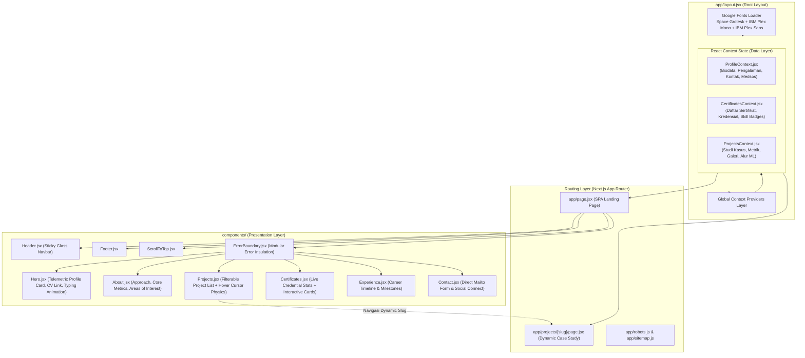

# 📘 Codebase & Architecture Guide: Kevin Adiputra Portfolio Website

> **Notice for AI Assistants & Autonomous Agents:**  
> Dokumen ini adalah panduan arsitektur teknis lengkap untuk proyek website portofolio Kevin Adiputra. Gunakan dokumen ini sebagai *single source of truth* (SSOT) ketika menganalisis, memodifikasi, menambah fitur, memperbaiki bug, atau melakukan refactoring pada codebase ini.

---

## 1. Executive Summary & Tech Stack

Website ini adalah portofolio profesional untuk **Kevin Adiputra** (Machine Learning Engineer & Data Scientist). Website dibangun dengan estetika **Industrial Telemetry / High-Craft Brutalism** bernuansa gelap (*dark mode first*), fokus pada penyajian metrik teknis terukur, studi kasus machine learning end-to-end, dan pembuktian kredensial yang dapat diverifikasi secara publik.

### Core Technology Stack:
| Layer | Teknologi | Versi | Keterangan |
|---|---|---|---|
| **Framework** | Next.js (App Router) | `16.2.9` | Menggunakan Turbopack & React Server/Client Components |
| **Runtime / Library** | React & React DOM | `19.0.0` | React 19 runtime |
| **Styling** | Tailwind CSS + Custom CSS | `3.4.17` | Desain kustom dengan CSS Variables & Utility Tokens |
| **Animation Engine** | Framer Motion & GSAP | `^12.23.22` & `^3.13.0` | Spring physics, velocity-based tilt, viewport fade-ups |
| **Iconography** | Lucide React | `^0.525.0` | Ikon SVG teroptimasi |
| **Typography** | `next/font/google` | Built-in | Space Grotesk, IBM Plex Mono, IBM Plex Sans |
| **State Management**| React Context API | Native | ProfileContext, ProjectsContext, CertificatesContext |
| **Admin CMS/Auth** | Supabase SSR + PostgreSQL | Optional runtime integration | Server session refresh, admin membership, RLS-backed content tables |
| **Hosting & CI/CD** | Vercel & GitHub Actions | - | Static & Dynamic Server-rendered output |

---

## 2. Arsitektur Sistem & Alur Data

### 2.1 Diagram Arsitektur Komponen & Data Flow



### 2.2 Prinsip Arsitektur Utama
1. **Legacy Public Data Source (Fast & Deterministic):**
   Saat ini halaman publik masih membaca data legacy secara terstruktur dari `context/*.jsx`. Ini menjaga build tetap deterministik sampai provider publik dipindahkan ke Supabase.
2. **Defensive Error Boundaries:**  
   Setiap seksi di `app/page.jsx` dibungkus dalam `components/ErrorBoundary.jsx`. Jika ada komponen yang mengalami kegagalan kalkulasi/render, seksi lain tetap berfungsi normal tanpa menyebabkan *white screen* total.
3. **Smooth Scroll & Route Hybrid:**  
   Navbar `Header.jsx` mendukung dua tipe navigasi: *anchor scroll* (`#about`, `#projects`, dsb.) ketika pengguna berada di homepage, dan transisi rute Next.js ketika berada di halaman sub-studi kasus (`/projects/[slug]`).
4. **Admin CMS Boundary:**
   Area `/admin` menggunakan Supabase Auth untuk sesi, `admin_profiles` untuk otorisasi pemilik, dan Row Level Security untuk membedakan draft dengan konten published. Public content providers masih menjadi sumber data legacy sampai migrasi Supabase diterapkan dan editor CRUD dihubungkan.

---

## 3. Struktur Direktori & File Manifest

```text
D:\PORTOFOLIO\My-Personal-Portofolio\
├── app/                              # Next.js App Router
│   ├── favicon.ico                   # Favicon
│   ├── globals.css                   # Master Tailwind config, CSS Variables & design tokens
│   ├── layout.jsx                    # Root layout, Google Font Injection, Global Context Providers
│   ├── page.jsx                      # Single-Page Application (Landing Page agregat)
│   ├── error.jsx                     # Fallback error page global
│   ├── robots.js                     # Dynamic SEO robots.txt generator
│   ├── sitemap.js                    # Dynamic SEO XML sitemap generator
│   └── projects/
│       └── [slug]/
│           └── page.jsx              # Template dinamis untuk studi kasus proyek
│
├── components/                       # Atomic & Organism UI Components
│   ├── About.jsx                     # Ringkasan filosofi data, statistik pengalaman, bidang minat
│   ├── Certificates.jsx              # Komputasi statistik sertifikasi live & kartu kredensial
│   ├── Contact.jsx                   # Form kontak mailto generator & tautan media sosial
│   ├── ErrorBoundary.jsx             # React Error Boundary untuk isolasi error per seksi
│   ├── Experience.jsx                # Riwayat karir, posisi, dan deskripsi kontribusi
│   ├── Footer.jsx                    # Navigasi bawah, hak cipta, dan social chips
│   ├── Header.jsx                    # Glassmorphism navbar dengan sticky header & responsive mobile drawer
│   ├── Hero.jsx                      # Header hero, terminal telemetry card, tombol download CV
│   ├── Projects.jsx                  # Filterable project list dengan floating thumbnail cursor physics
│   ├── ScrollToTop.jsx               # Tombol melayang untuk kembali ke atas halaman
│   └── Skills.jsx                    # Arsip visualisasi skill berbasis kategori (opsional/modular)
│
├── context/                          # State Management & Dataset Pusat
│   ├── CertificatesContext.jsx       # Database sertifikat, platform, issuer, credential URL
│   ├── ProfileContext.jsx            # Biodata pribadi, peran, lokasi, email, nomor HP, foto profil
│   └── ProjectsContext.jsx           # Database proyek (8 studi kasus lengkap: MLOps, ETL, CV, NLP, dll.)
│
├── public/                           # Static Assets (Next.js Root Static Server)
│   ├── certificates/                 # Gambar sertifikat (jika ada)
│   ├── projects/                     # Screenshot hasil visualisasi, dashboard, dan grafik model ML
│   ├── profile-picture.jpg           # Foto profil utama Kevin Adiputra
│   └── *.svg                         # Icon & placeholder SVG fallback

├── lib/                              # Server/browser integration helpers
│   ├── admin-auth.js                 # Server-side admin authorization gate
│   ├── admin-data.js                 # Database-backed dashboard snapshot
│   └── supabase/                     # Browser, server, and proxy clients
├── supabase/migrations/              # Reviewable PostgreSQL schema + RLS
├── app/admin/                        # Protected admin shell and CMS route boundary
├── components/admin/                 # Admin shell, logout, and dashboard primitives
│
├── jsconfig.json                     # Path alias `@/*` mengarah ke root proyek
├── next.config.mjs                   # Konfigurasi Next.js 16 (Turbopack ready)
├── package.json                      # Manifest dependensi & skrip NPM
├── postcss.config.js                 # Plugin Autoprefixer & Tailwind
└── tailwind.config.js                # Token warna, font family, dan animasi kustom
```

---

## 4. Design System & Aturan Styling (Wajib Dipatuhi)

Untuk menjaga konsistensi visual, seluruh komponen mengikuti pedoman berikut:

### 4.1 Token Warna (`tailwind.config.js` & `globals.css`)
```css
:root {
  --color-primary: #0b0b12;        /* Latar belakang utama (Deep Slate/Void Black) */
  --color-secondary: #12151d;      /* Latar belakang kartu/seksi sekunder */
  --color-accent: #68d4cc;         /* Aksen Telemetri (Cyan/Mint Glow) */
  --color-accent-hover: #8ae4dc;   /* State hover warna aksen */
  --color-tertiary: #1a1f2a;       /* Permukaan panel elevated */
  --color-tertiary-hover: #232a37; /* State hover panel */
  --color-muted: #9da9b8;          /* Teks redup */
}
```

### 4.2 Tipografi
* **Display Font (`--font-display` / Space Grotesk):** Digunakan untuk seluruh Heading besar (`h1`, `h2`, `h3`, nama proyek, persentase metrik).
* **Mono Font (`--font-mono` / IBM Plex Mono):** Digunakan untuk label telemetri, tanggal, badge kategori, timeline, dan nomor indeks (`01.`, `02.`).
* **Body Font (`--font-body` / IBM Plex Sans):** Digunakan untuk teks deskripsi, narasi masalah (*challenge*), solusi, dan paragraf panjang.

### 4.3 Karakteristik Visual & Elemen Unik
1. **Sharp Brutalist Corners:**  
   Gunakan `rounded-none` pada tombol utama (`.btn`), kartu proyek, dan panel data. Hindari penggunaan `rounded-full` atau border-radius besar kecuali untuk avatar atau badge kecil.
2. **Technical Borders:**  
   Border standar menggunakan `border border-white/10`. Saat hover, ubah ke `hover:border-accent/30` atau `hover:border-accent`.
3. **Utility Classes Kustom di `globals.css`:**
   * `.surface-card`: Kartu bertingkat dengan subtle inner highlight.
   * `.glass-panel`: Panel efek kaca dengan `backdrop-blur-md`.
   * `.chip` & `.chip-active`: Badge filter kategori teknis.
   * `.hero-grid`: Background grid geometris 90x90px berkedalaman lembut.
   * `.data-ribbon`: Pita pembatas data semi-transparan.

---

## 5. Skema Data & Model Context

Setiap AI yang ingin menambah atau memodifikasi data **harus** mengikuti struktur schema di bawah ini:

### 5.1 Skema Proyek (`context/ProjectsContext.jsx`)
```typescript
interface Project {
  id: number;
  slug: string;                  // URL slug unik: e.g. "end-to-end-mlops-pipeline"
  title: string;                 // Judul resmi proyek
  tagline: string;               // Ringkasan 1 kalimat
  description: string;           // Penjelasan komprehensif
  image: string;                 // Path gambar di /public: e.g. "/projects/foo.png"
  technologies: string[];        // Array teknologi: ["Python", "Docker", "MLflow"]
  category: "mlops" | "data-engineering" | "data-science" | "deep-learning" | "nlp";
  date: string;                  // Tahun: "2024" atau "2026"
  year: string;
  status: "Completed" | "In Progress";
  liveUrl: string;               // URL demo ("#" jika tidak ada)
  githubUrl: string;             // URL repositori GitHub ("#" jika tidak ada)
  featured: boolean;
  highlight: boolean;            // Ditampilkan pada filter "Case Studies"
  metrics: Array<{
    label: string;               // e.g. "Test Accuracy"
    value: string;               // e.g. "97.0%+"
    description: string;         // e.g. "Generalization score on test set"
  }>;
  overview: string;              // Penjelasan latar belakang bisnis/teknis
  challenge: string;             // Kendala teknis utama (overfitting, scaling, data skewness)
  solution: string;              // Solusi arsitektural yang diimplementasikan
  process: Array<{
    phase: string;               // e.g. "Data Pipeline", "Model Training"
    description: string;         // Langkah detail yang dilakukan
  }>;
  gallery: Array<{
    image: string;               // Visualisasi grafik / dashboard dari /public/projects/
    title: string;
    description: string;
  }>;
  learnings: string[];           // Poin kunci pembelajaran teknis
}
```

### 5.2 Skema Sertifikat (`context/CertificatesContext.jsx`)
```typescript
interface Certificate {
  id: number;
  title: string;
  issuer: string;                // e.g. "Dicoding Indonesia", "Astronomer"
  platform: string;
  date: string;                  // e.g. "2025"
  issued: string;                // e.g. "July 2025"
  expires: string;
  image: string;
  credentialId: string;
  skills: string[];
  description: string;
  credentialUrl: string;         // Link verifikasi publik (Credly, Dicoding, dll.)
  featured: boolean;
  category: "Machine Learning" | "MLOps & Infrastructure" | "Data Engineering" | "Generative AI";
  level: "Beginner" | "Intermediate" | "Advanced" | "Professional";
  duration: string;
}
```

### 5.3 Skema Profil (`context/ProfileContext.jsx`)
Menyimpan informasi personal: `name`, `title`, `bio`, `profilePicture` (`/profile-picture.jpg`), `email`, `phone`, `location`, `linkedin`, `github`, `website`, `skills`, `experience`, dan `education`.

### 5.4 Admin CMS Schema (`supabase/migrations/202610250001_admin_cms.sql`)
Menyediakan tabel `admin_profiles`, `projects`, `certificates`, `experience`, `education`, `skills`, `profiles`, dan `site_settings`. Tabel konten memiliki `is_published`, `display_order`, `created_at`, dan `updated_at` bila relevan. RLS mengizinkan pembacaan publik hanya untuk konten published; admin memperoleh akses CRUD setelah user Supabase dimasukkan ke `admin_profiles`.

---

## 6. Detail Studi Kasus Proyek yang Terdaftar

Saat ini, website memiliki 8 proyek unggulan:
1. **`end-to-end-mlops-pipeline`** (MLOps): Pipeline lifecycle ML lengkap dengan MLflow, FastAPI, Docker, Prometheus, Grafana, dan GitHub Actions CI/CD.
2. **`fundamental-data-processing-etl-pipeline`** (Data Engineering): Pipeline ETL otomatis scraping Fashion Studio Dicoding, konversi kurs valuta USD-IDR, Google Sheets API ingestion, dan pengujian unit test pytest 100% code coverage.
3. **`above-ground-biomass-estimation`** (Data Science & Remote Sensing): Estimasi biomassa dan serapan stok karbon (AGC) di PT Pupuk Sriwidjaja Palembang menggunakan persamaan alometrik, regresi XGBoost/Random Forest, dan dashboard Streamlit interaktif.
4. **`user-behavior-predictive-analysis`** (Data Science): Klasifikasi perilaku pengguna perangkat seluler (700 baris data) membandingkan 9 model klasifikasi dengan 5-fold cross validation.
5. **`ecommerce-data-analysis`** (Data Science): Analisis 100k+ transaksi e-commerce, pembersihan outlier IQR payment value, transformasi logaritmik/akar kuadrat, dan demografi pelanggan.
6. **`cifar10-image-classification`** (Deep Learning): Klasifikasi 10 kategori objek menggunakan Convolutional Neural Network (CNN) multi-layer dengan Batch Normalization dan Dropout di Google Colab.
7. **`sentiment-analysis-subway-surfers`** (NLP): Analisis sentimen ulasan Google Play Store pada game Subway Surfers menggunakan kamus leksikon NLTK VADER.
8. **`rock-paper-scissors-image-classification`** (Computer Vision): Model CNN pengenal gestur tangan gunting-batu-kertas dengan augmentasi data dan optimizer RMSprop (akurasi validasi 97%+).

---

## 7. Instruksi & Aturan Khusus untuk AI Pengembang

Jika AI lain membaca atau memodifikasi repository ini, **patuhi instruksi mutlak berikut**:

### 🚫 Pantangan Keras (Anti-Patterns):
1. **JANGAN gunakan path `public/...` di dalam kode JavaScript/JSX!**
   * *Salah:* `src="public/projects/gambar.png"`
   * *Benar:* `src="/projects/gambar.png"`
   * *Alasan:* Next.js menyajikan seluruh isi folder `/public` langsung pada root `/`. Menuliskan kata `public` akan menghasilkan error **404 Not Found**.
2. **JANGAN gunakan syntax shell `&&` di Windows PowerShell:**
   * Di terminal PowerShell Windows, gunakan titik-koma `;` sebagai pemisah perintah beruntun:
     `git add . ; git commit -m "update" ; git push origin main`
3. **JANGAN ubah estetika menjadi rounded / soft pastel:**
   * Desain portofolio ini mengusung tema **High-Tech Telemetry**. Pertahankan sudut tajam (`rounded-none`), aksen cyan-mint glow (`#68d4cc`), dan font mono untuk angka statistik.
4. **JANGAN merusak dynamic route React 19:**
   * Pada `app/projects/[slug]/page.jsx`, parameter di-*unwrap* menggunakan `React.use(params)` sesuai standar React 19 / Next.js 16. Jangan mengubahnya kembali ke pembacaan synchronous lawas yang memicu runtime warning.

### ✅ Standar Modifikasi yang Disarankan:
1. **Menambah Proyek Baru:**
   * Tambahkan entri baru ke dalam array `projectsData` di [context/ProjectsContext.jsx](file:///D:/PORTOFOLIO/My-Personal-Portofolio/context/ProjectsContext.jsx).
   * Letakkan gambar aset visual di folder `public/projects/`.
   * Pastikan field `slug`, `metrics`, `overview`, `challenge`, `solution`, `process`, `gallery`, dan `learnings` terisi lengkap.
2. **Mengganti Foto Profil:**
   * Masukkan foto baru ke `public/profile-picture.jpg` atau ubah nama file di [context/ProfileContext.jsx](file:///D:/PORTOFOLIO/My-Personal-Portofolio/context/ProfileContext.jsx).
3. **Mengupdate Tautan CV:**
   * Tombol download CV utama berada di [components/Hero.jsx](file:///D:/PORTOFOLIO/My-Personal-Portofolio/components/Hero.jsx#L124).
4. **Verifikasi Sebelum Commit:**
   * Selalu jalankan `npm run build` untuk memverifikasi bahwa static compilation Next.js dan TypeScript linting berhasil 100% tanpa error.
5. **Admin CMS:**
   * Jangan menambahkan password, service-role key, atau bypass RLS ke source code.
   * Terapkan migrasi Supabase dan buat row `admin_profiles` untuk user owner sebelum menguji `/admin`.

---

## 8. Skrip & Perintah Operasional

```bash
# Menjalankan development server (port 3000)
npm run dev

# Kompilasi build produksi (Turbopack)
npm run build

# Menjalankan hasil build produksi lokal
npm run start

# Menjalankan static code analysis
npm run lint
```
